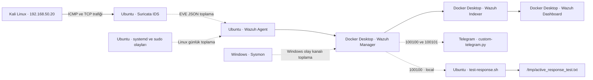

# Sistem mimarisi

[Proje ana sayfası](../README.md) · [Kurulum](setup.md) · [Doğrulama](validation.md)

## Ağ ve uç noktalar

| Sistem | Konum | Bileşen ve rol |
| --- | --- | --- |
| Kali Linux | VirtualBox, `192.168.50.20` | Kontrollü doğrulama trafiğinin kaynağı. |
| Ubuntu Server | VirtualBox, `192.168.50.10` | Suricata IDS ağ sensörü ve Linux günlüklerini toplayan Wazuh Agent. |
| Windows | Docker Desktop ana makinesi | Wazuh Manager, Indexer ve Dashboard konteynerleri. Manager konteyner adı `single-node-wazuh.manager-1`. |
| Windows | Windows olay kaynağı | Sysmon telemetrisi. Sysmon XML’i, etkin olay filtresi ve Windows olay toplayıcısının dağıtım ayarları depoda bulunmuyor. |

`192.168.50.20` ve `192.168.50.10`, Suricata kural başlıklarında kullanılan laboratuvar adresleridir. Suricata’nın etkin dinleme arayüzü ve VirtualBox adaptör eşlemesi kurulum sırasında doğrulanmalıdır.

## Olay ve alarm akışı

Kesikli oklar, yapılandırmaya bağlı veya uçtan uca çalışması bu depodaki kanıtlarla doğrulanmamış bağlantıları gösterir.

### Ağ tespiti ve Linux olayları

Suricata, [üç yerel imzayı](../suricata/rules/local.rules) izlenen arayüzdeki paketlere uygular. EVE JSON toplama etkinse Ubuntu’daki Wazuh Agent yapılandırılmış olay dosyasını Manager’a iletir. Wazuh’un belgelenen Suricata bağlantısı `/var/log/suricata/eve.json` yolunu kullanır. Depoda etkin Suricata YAML’ı veya Ubuntu Agent yapılandırması bulunmadığından gerçek çıktı yolunu ve toplama ayarını hedef sistemde kontrol edin. [Wazuh Suricata entegrasyonu](https://documentation.wazuh.com/current/proof-of-concept-guide/integrate-network-ids-suricata.html)

Suricata’nın paket alarmı ile `100100` numaralı servis durdurma alarmı farklı olay kaynaklarına dayanır. `100100`, `systemd` mesajını değerlendirir. `100101` ise ayrı bir Linux `sudo` olayına dayanır. Bu iki yolun giriş koşulları [Wazuh kural XML’inde](../wazuh/manager/rules/local_rules.xml) görülür.

### Windows telemetrisi

Wazuh `100102`–`100106` kuralları Sysmon olay gruplarına veya bir üst kurala ve `win.eventdata.*` alanlarına dayanır. Süreç oluşturma, dosya oluşturma ve kayıt defteri değişikliği birbirinden farklı olay türleridir. Windows tarafında kullanılan toplama yapılandırması ve Sysmon filtreleri depoda olmadığı için kuralların hangi olaylarla beslendiği uçtan uca doğrulanmalıdır. FIM ve auditd için bu depoda yapılandırma veya doğrulama kanıtı bulunmuyor.

### Bildirim ve yerel yanıt

- **Telegram.** Manager’da gözlenen `<integration>` tanımı `100100` ve `100101` kurallarını filtreliyor. [Python betiği](../integrations/telegram/custom-telegram.py) bir alarm JSON dosyası ile yerel Telegram yapılandırmasını okuyor ve kural ID’si, seviye, açıklama ve agent adını Bot API’ye gönderiyor. Manager’da `custom-telegram` adlı giriş dosyası eksik ve canlı teslimat henüz doğrulanmadı.
- **Active Response.** Manager’da gözlenen `custom-test-action` tanımı `100100` alarmını `location=local` ile `test-response.sh` dosyasına bağlıyor. Olayı üreten agent eylemi yerel olarak çalıştıracak biçimde yapılandırılmış. [Depodaki betik](../wazuh/active-response/test-response.sh) yalnızca zaman damgalı bir test günlüğü oluşturur veya günlüğe satır ekler. Manager’da ayrıca ayrı bir standart `firewall-drop` tanımı gözlendi. [Active Response çalışma konumu](https://documentation.wazuh.com/current/user-manual/reference/ossec-conf/active-response.html)
